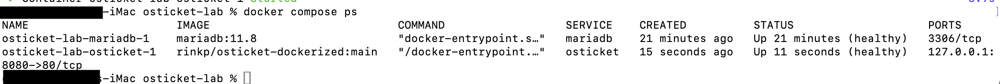
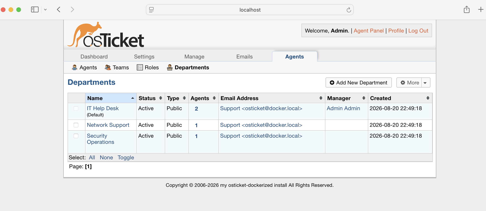
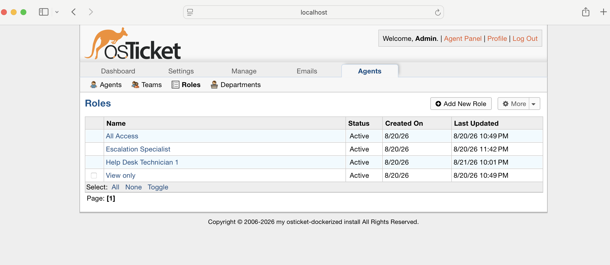
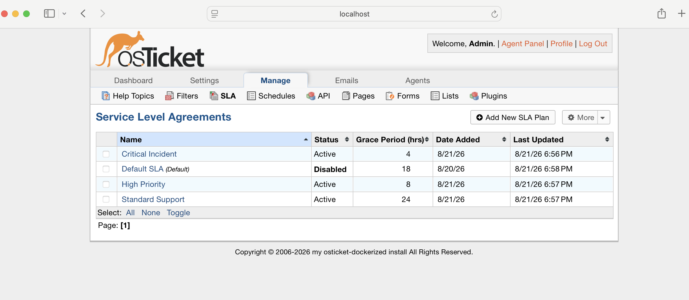
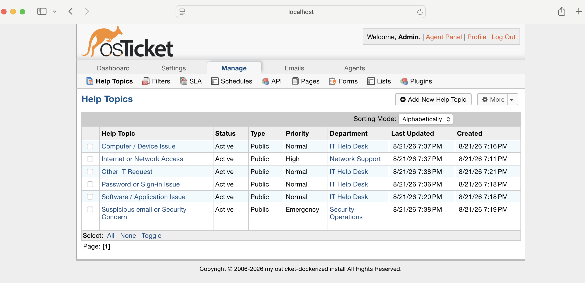
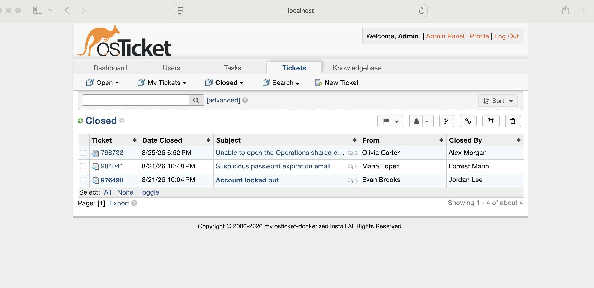
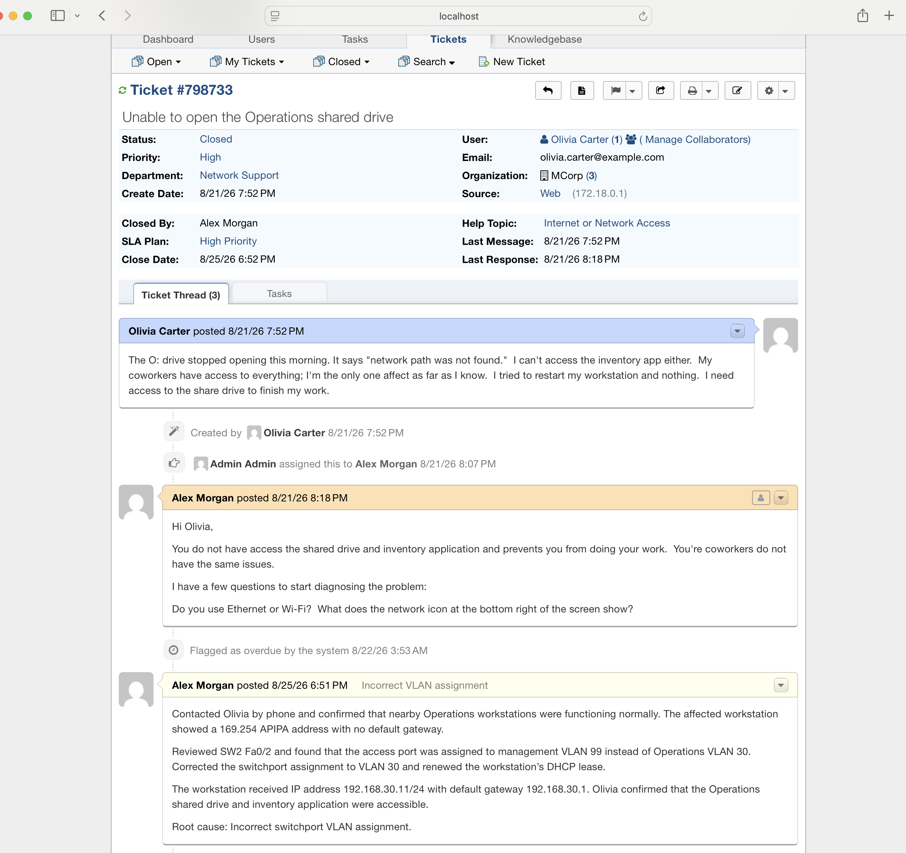
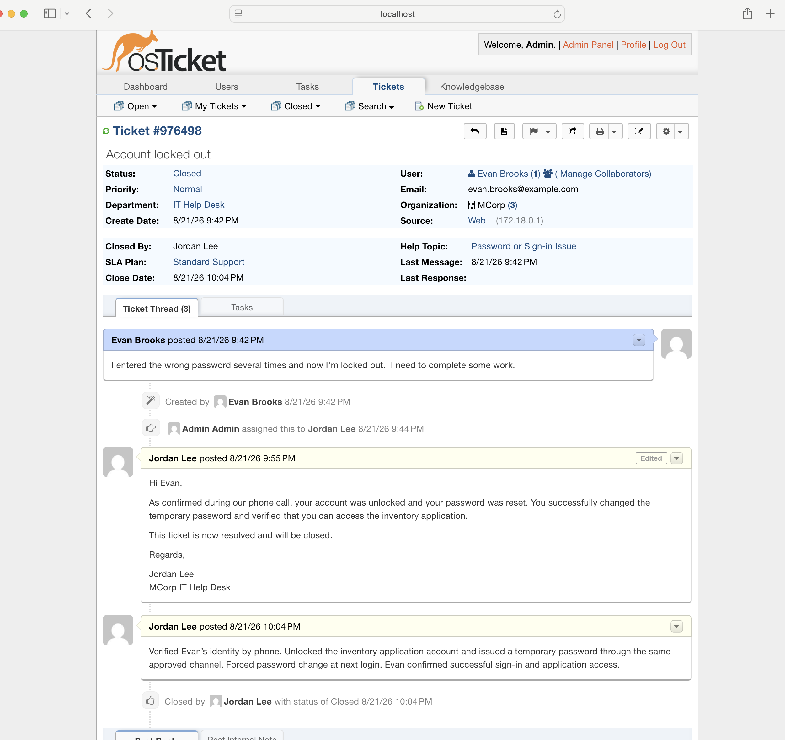
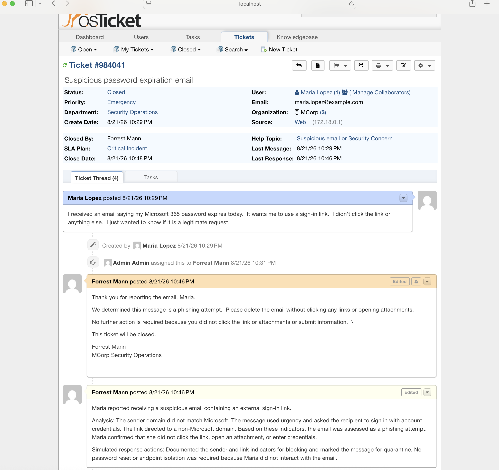

# osTicket IT Support Lab

## About this project

I built this lab to get hands-on experience with a ticketing system and learn how help desk work is organized and documented.

I used osTicket to create a fictional company called **MCorp**. I set up support departments, technician accounts, user accounts, roles, SLAs, Help Topics, and three sample tickets. I also practiced the difference between public replies to users and private internal notes for technicians.

This was a simulated lab. MCorp, the employees, and the support tickets are fictional.

## Lab setup

I ran the lab on an M1 iMac with 8 GB of RAM. I used Docker Desktop instead of another virtual machine because I wanted to keep the resource usage low.

The environment has two containers:

- osTicket for the help desk application
- MariaDB for the ticket database

The osTicket portal is available only from my iMac at `http://localhost:8080`. MariaDB is not exposed to my home network. I also used Docker volumes so the database and attachments remain saved when the containers stop or restart.

## Help desk configuration

I created three support departments:

- IT Help Desk
- Network Support
- Security Operations

I created separate roles for Help Desk Technicians and Escalation Specialists. I kept administrative permissions separate from the technician roles.

I also created three SLA plans:

- Critical Incident: 4 hours
- High Priority: 8 hours
- Standard Support: 24 hours

## Help Topics

I made the topics so users could choose based on what they were experiencing:

- Password or Sign-In Problem
- Computer or Device Problem
- Application or Software Problem
- Internet or Network Access
- Suspicious Email or Security Concern
- Other IT Request

The Help Topic automatically sends the ticket to the correct department and applies its priority and SLA.

## A Docker problem I had to troubleshoot

After I started the containers, the osTicket website opened normally and returned an HTTP 200 response, but Docker still reported the container as unhealthy.

I inspected the container health-check results and found this error:

`/bin/sh: curl: not found`

The image was trying to use `curl` for its health check, but `curl` was not installed in the container. I checked the container and found that `wget` was available. I tested it against the local osTicket page, and it worked.

I updated `compose.yaml` to override the original health check and use `wget --spider` instead. After recreating the osTicket container, both osTicket and MariaDB showed as healthy.

This helped me understand that an application can be working even when its container health check is failing. The health check itself can be the problem.

## Ticket examples

I completed three tickets covering network support, account support, and security.

### Ticket 1: Operations shared drive unavailable

Olivia from Operations reported that she could not open the mapped O: drive or MCorp's inventory application. Other employees nearby were still working normally.

The troubleshooting notes showed that her workstation had a 169.254 APIPA address and no default gateway. The switchport connected to her workstation, SW2 Fa0/2, was assigned to management VLAN 99 instead of Operations VLAN 30.

The port was corrected to VLAN 30 and the workstation renewed its DHCP lease. It received `192.168.30.11/24` with gateway `192.168.30.1`. Olivia confirmed that the shared drive and inventory application worked again before the ticket was closed.

This ticket was based on my separate Packet Tracer network lab. Packet Tracer and osTicket were not actually connected.

### Ticket 2: Account locked

Evan entered the wrong password several times and was locked out of the inventory application.

The Help Desk technician documented that Evan's identity was verified by phone. The account was unlocked, a temporary password was provided through the separate phone call, and Evan had to create a new password when he signed in.

Evan confirmed that he could access the application, and the ticket was closed.

### Ticket 3: Suspicious email

Maria reported an email claiming that her Microsoft 365 password was about to expire. The message used urgency and included an external sign-in link. Maria did not click the link, open an attachment, or enter her credentials.

The internal note documented that the sender domain did not match Microsoft and that the link went to a non-Microsoft domain. Based on those indicators, the message was assessed as phishing.

For the simulated response, the sender and link indicators were documented for blocking and the message was marked for quarantine. Because Maria did not interact with it, a password reset or endpoint isolation was not necessary.

## What I learned

This lab gave me experience with:

- Installing and running osTicket with Docker Compose
- Working with a MariaDB-backed application
- Using persistent Docker volumes
- Troubleshooting a failed container health check
- Creating departments, agents, users, roles, and permissions
- Setting priorities and SLA deadlines
- Designing Help Topics for end users instead of technicians
- Assigning, documenting, resolving, and closing tickets
- Separating user-facing replies from internal technical notes
- Writing down the symptoms, troubleshooting, root cause, fix, and user confirmation

Someone else should be able to read and understand what the user reported, what the technician checked, what caused the problem, what fixed it, and how the fix was verified, so this was great practice documenting these steps to see how a ticket becomes a final product.

## Project files

- `compose.yaml` contains the Docker configuration.
- `.env` contains private passwords and is excluded from GitHub.
- `screenshots/` contains the evidence from the lab.

To start the lab again, I open Docker Desktop, change to the project folder, and run:

`docker compose up -d`

To check the containers:

`docker compose ps`

To stop the containers without deleting the saved data:

`docker compose stop`
